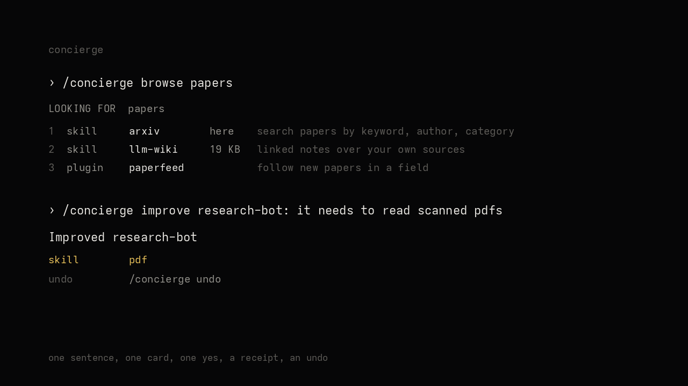

# Concierge

[](https://github.com/dresraz/hermes-concierge/tags)
[](LICENSE)
[](tests)
[](plugin.yaml)

**The front door to the Hermes marketplace.**

A marketplace concierge. One sentence upgrades your default profile or any bot you already have, or
adds a new one. No catalog to learn, no manifest to read, no restart. One card, one yes, a receipt
read off the disk, and one undo.



Two moves over one marketplace: **create** a bot, or **improve** one. Both pull from what is
already installable, and both end with a receipt you can check and an undo that restores it.

Every bot it makes gets a `/concierge` it can use on itself, so you can say `get the skills you need
for this job` in that bot's own chat and it pulls what it is missing. In there it is scoped to
itself: no new bots, no deleting profiles, no reaching another bot.

Concierge is a Hermes Agent plugin. It answers one question, *"can I add that?"*, without making
you learn the catalog, read a manifest, or guess which of the a thousand-odd entries does the thing.

```
/concierge remember what I told you across sessions
```

```
Concierge

  you said    remember what I told you across sessions
  best match  cognee  (community, memory)
  why         remember, across, sessions
  what        Knowledge-graph memory for Hermes, shared with Cognee's Claude Code, Codex and OpenClaw plugins: automatic recall, remember, forget, recaps and code search
  adds        6 tools, 4 hooks
  cost        6 tools, sent on every request like every other tool
  install     https://github.com/topoteretes/cognee-integrations v1.4.1 @ b13274096018

  also        entropicmem  (community)

Install it?  /concierge yes   or   /concierge no
```

The runner-up is named, never numbered. `/concierge more` describes it and `/concierge entropicmem` installs it by name. No single key installs something the card did not describe.

`/concierge yes` installs it through Hermes's own catalog installer, with Hermes's own scan report and consent gate, then reads the result back off the disk:

```
Installed cognee

  on disk     $HERMES_HOME/plugins/cognee (76 files)
  enabled     yes
  scan        safe, 80 notes

Undo it with /concierge undo
```

The `notes` count is core's own advisory list from its isolation report, not a finding. The verdict word is the decision.

When nothing fits, it installs nothing:

```
  best match  none

Nothing in the catalog does that yet. Nothing was installed.
```

The matcher is keyword-based, so a nonsense sentence can still surface one weak card
(it never installs anything without your yes). On our junk set, 7 of 8 absurd asks
return nothing at all.

## One command

Everything is a word after `/concierge`: `create`, `improve`, `browse`, `bots`, `fire`, `reset`, `undo`.

```
  CONCIERGE
  Bots, plugins and skills, one sentence at a time.

  /concierge                     the shelf: what can be added
  /concierge browse <word>       look through the shelf
  /concierge <sentence>          install a plugin or skill, this profile
  /concierge create <sentence>   make a new bot
  /concierge improve <bot>: <what>  add what that bot is missing
  /concierge bots                list the bots Concierge made
  /concierge fire <n>            delete bot number n
  /concierge reset <n>           take back what Concierge changed in bot n
  /concierge undo                take back the last thing Concierge did
  /concierge help                this list

  Add "into <bot>" to install into a bot instead of this profile.
  improve works on any bot on this machine, not only ones Concierge made.
```

`/concierge` with nothing after it opens the shelf. `/concierge help` prints the command list.

Inside a bot, the same command works on that bot alone: it can pull the skill it needs or write a
rule into its own soul, and it cannot make bots, delete profiles, or reach another bot. The owner's
profile keeps full power over all of them.

## Look first, if you do not know what to ask for

A sentence is fast when you know the word. When you do not, the shelf is a window on everything
that exists, read at the moment you look:

```
  /concierge browse notes
  LOOKING FOR  notes

  1  bot     assistant       6 skills  own inbox, calendar, files and notes
  2  bot     tutor           5 skills  cards, diagrams, explainers, search over your own notes
  3  skill   obsidian        3 KB      Read, search, create and edit notes in the Obsidian vault
  4  plugin  sticky-notes              Floating notes on your desktop
```

A number acts on that row: a skill installs here, a plugin opens its card, a bot gets made. The
list is generated per request and never stored, so what you install leaves the ready side, and a
listing expires after ten minutes rather than acting on yesterday's numbers.

## The point: a working bot in one sentence, better every week

Hermes gives you a lot of power and asks you to assemble it. That is the slow part. You read the
catalog, guess which of the a thousand-odd entries matters, install six into a profile, write the
instructions that make the profile behave, then find out it was the wrong six.

Concierge removes that stretch. You say the job and it picks the skills that finish the job,
writes the soul that makes the bot act like that job, then reads the disk before it calls it done.
It copies your plugin switches and your model login too, so the bot starts from your setup and
answers on its first message. The login copy has every messaging channel stripped, so two profiles
never fight over one bot token.
A researcher arrives on its first sentence able to read papers, cite sources, save notes and get
past a blocked page, without you knowing those four skills exist.

Then it stays cheap to change. `improve` adds what a bot is missing in one sentence: a skill from
the marketplace, or one rule in its soul. Nothing gets rebuilt. Trying a bot costs a sentence and an undo, so people experiment instead
of deliberating. Opinionated starting sets, one-sentence changes, a receipt that tells the truth:
that is the speed argument.

## Why not just ask the agent?

You can. Your `default` agent has a terminal, so "add the pdf skill to researcher-bot" already
works, and so does writing the soul by hand. Concierge adds no new power.

What it adds is the boring part. It matches against the real catalog, so it cannot invent a skill
or plugin name. It shows one card and waits for a yes. It reads the disk before it claims the
install, and it records what it wrote so `undo` reverses exactly that. When nothing fits it installs
nothing and says so. No model call, no tokens, same answer every time.

## Install anything: plugins and skills, here or into a bot

The sentence search covers both shelves the marketplace has: the plugin catalog and the skill
registries. Say what you want and where it should land.

```
/concierge stripe payments
/concierge a skill for writing commit messages into intern
```

```
CONCIERGE
  you said    a skill for writing commit messages
  best match  writing-for-agents  (skill)
  into        bot intern  (not this profile)
  install     anthropics/skills v1.0.0
Install it?  /concierge yes   or   /concierge no
```

```
Installed writing-for-agents
  on disk     /home/andres/.hermes/profiles/intern/skills/writing-for-agents (3 files)
  into        intern
Undo it with /concierge undo
```

Leave out the bot and it goes into the profile you are talking to. The word after `into` has to be
an existing profile; a typo means the card says `this profile` instead of landing somewhere else
quietly. Undo follows the receipt, so a skill installed into `intern` comes back out of `intern`.

One caution: Concierge does not recommend **memory plugins**. They hook the agent's own memory, so
they can depend on your setup, a hosted service or a paid plan, and a bad one changes every
conversation you have. Install those by hand, one at a time, after reading what they need.

## Create: a sentence becomes a bot

```
/concierge create bp-test-zero: keeps my inbox at zero and drafts replies
```

```
Hired bp-test-zero

    home     /home/andres/.hermes/profiles/bp-test-zero
    soul     SOUL.md, 265 chars
    skills   0 installed
    profile  listed by hermes profile list
  plugins  your setup, 46 switches, 5 not available here

  next     /concierge improve bp-test-zero: <habit>
  undo     /concierge undo
```

The word before the colon is the name. Without a colon the name is the last meaningful word, so `/concierge create keeps my inbox at zero` creates `inbox-bot`.

Ten roles also bring their skills, so the bot arrives able to work:

```text
/concierge create a researcher for papers

Hired researcher-bot

    home     /home/andres/.hermes/profiles/researcher-bot
    soul     SOUL.md, 1084 chars
    skills   9 installed
    profile  listed by hermes profile list
  plugins  your setup, 46 switches, 5 not available here
  skills   researcher 8/8 installed: parallel-cli, qmd, llm-wiki, rss-feeds, arxiv, grounded-citations, blocked-page-recovery, pdf

  next     /concierge improve researcher-bot: <habit>
  undo     /concierge undo
```

The roles are `researcher`, `writer`, `coder`, `assistant`, `marketer`,
`watcher`, `designer`, `analyst`, `tutor`, `planner`. Each role lands seven to
nine catalog skills: optional skills installed through core's own `hermes -p
<profile> skills install`, plus bundled-tree skills copied in after that pool,
then the disk is read before the receipt says anything. The receipt counts every
real `SKILL.md` in the profile, including the `hermes-agent` skill every profile
starts with, so it can read one higher than the role's pick count. Each role also
lands a soul written for that job, so the bot knows how to behave on its first
sentence. The full table is `docs/PRESETS.md`.

The bot is created through core's own `create_profile`, so it shows up in `hermes profile list` like any other profile, with its own memory, skills and cron.

## Every bot gets its own Concierge

A bot Concierge makes gets the command too, linked to the same plugin so one update
reaches every bot. Inside that bot it can only work on itself: read the shelf, get
the skill it needs, write a rule into its own soul. It cannot make bots, delete
profiles, or touch another bot. The owner's profile keeps full power over all of them.

```
/concierge get the skills you need for this job
```

## Improve: the other half

`create` makes a bot. `improve` makes one better, and it works on any bot on the machine, not
just the ones Concierge made:

```
  /concierge improve researcher-bot: it needs to read scanned PDFs
  Improved researcher-bot

    skill    pdf

    undo     /concierge undo
```

A capability installs a real skill from what the marketplace already holds. A rule goes into the
bot's soul, where every turn reads it:

```
  /concierge improve my researcher: always show the source first
  Improved researcher-bot

    rule     always show the source first
```

Rules are deduped, capped, written atomically and backed up one per rule, so undo restores the
exact bytes the rule replaced instead of guessing. Three things per improve at most.

## What the bot is made of

| part | comes from |
|---|---|
| `SOUL.md` | your sentence, written before the receipt prints |
| skills | the role's picks, nothing when no role matched |
| plugins | your own switches, copied in |
| memory, cron, sessions | empty, and the bot's own from its first turn |

**Plugins follow your setup, not the app's defaults.** A new profile has no `plugins:` block, so every bundled plugin falls back to whatever Hermes ships and the bot comes up with switches you never chose. Concierge copies your switch lists into the bot and drops any name that only exists in your home, since those folders are not inside the profile. The receipt counts both:

```
  plugins  your setup, 46 switches, 5 not available here
```

When you have no switches of your own it says `plugins  stock defaults` and writes nothing.

**A role can carry skills, not plugins.** A skill is a folder copied into the bot's own `skills/`, so a role brings it. A plugin install writes into a home, and the bot is a different home, so when a job wants one the card names it and you install it in your own profile.

Improving is a sentence too:

```
/concierge improve bp-test-zero: always answer in one line
```

```
Improved bp-test-zero

    rule     always answer in one line

    undo     /concierge undo

  undo     /concierge undo
```

## Lifecycle: the bots it made, in one sentence

```
/concierge bots
```

```
  BOTS  2

   1  inbox-bot       Triage my inbox
   2  newsletter-bot  Writes my weekly newsletter

  fire <n>    delete that bot
  reset <n>   take back what Concierge changed in it
```

`fire` deletes a bot Concierge created. `reset` takes back only Concierge's own changes and leaves the bot standing:

```
Reset: inbox-bot (2 changes)

  removed: skill $HERMES_HOME/profiles/inbox-bot/skills/always-answer-in-one-line
  kept: the bot itself (delete it with /concierge fire)
```

Both take a number or a name.

A bot that has never been used fires on one word. A bot with sessions, memory or cron jobs makes you type its name back first, because that history is the one thing no undo can return:

```
/concierge fire 2

  Not fired: inbox-bot

    inbox-bot has history: 14 sessions, 2 memory files. Firing it throws that away, and nothing brings it back.
    To do it anyway: /concierge fire 2 inbox-bot
```

`undo` never deletes a used bot. On a bot nothing has happened in, it kills it. On a bot that has been lived in it
says `kept: ... has history ...` and points at `fire`.

**`default` is never deleted.** `fire default` is refused and points at `reset default`, which
replays only the records Concierge wrote for that profile. Any profile Concierge did not create is
refused too, since it cannot safely delete what it cannot name.

## Why a plugin and not a prompt

A prompt cannot read the live catalog, rank every real entry in it against your sentence, call
core's installer, write an install record, or undo it. Concierge does all five and never invents a
plugin or a bot that does not exist.

## How it works

- `commands.py` is the whole command surface: one verb table, one card protocol, one record store.
- `match.py` ranks the live catalog against your sentence. Pure and deterministic: no model call, no
  network. It tokenizes, folds plurals, and bridges an outcome to a mechanism with a small
  hand-written vocabulary, so *"remember this forever"* reaches memory providers instead of scoring
  zero. Each candidate carries the words that earned it, which is what `why` prints.
- `card.py` renders the catalog card, takes the yes or no, and prints the receipt once an install lands.
- `market.py` is the other shelf: skills from the registries, into this profile or a named bot, with
  the same card, yes, receipt and undo. `split_target` reads `into <bot>` off the sentence.
- `lifecycle.py` lists, fires and resets. It is the only place that decides what may be deleted.
- `bots.py` turns a sentence into a profile name, a title, a duty list and a `SOUL.md`.
- `improve.py` turns a sentence into one skill from the marketplace, or one rule in the bot's soul.
- `shelf.py` is the window: the bots, the skills on disk and the catalog, numbered, expiring,
  and acted on by number.
- `discover.py` indexes the two skill trees Hermes ships, weighs each candidate (size, files,
  helper scripts, service tells) and refuses to call anything a free extra when it pipes a
  download into a shell.
- `commands.py` also routes: a bare sentence decides create, improve or install from the bots that
  exist, so a role you already have is improved rather than duplicated.
- `presets.py` holds the ten roles: cue detection, the five-to-eight skills each one lands, and the
  install-verify loop that believes the disk over the exit code.
- `plugins_inherit.py` copies your `plugins:` switches into a new bot and drops the names that only
  exist in your own home.
- `seams.py` is the only module that calls Hermes core: catalog, installer, scan gate, profiles, hook registration.
- `effects.py` holds the filesystem writes, injected so tests never touch a real directory.
- `undo.py` reverses the last thing Concierge did, then checks the disk before dropping the record.
- `state.py` keeps one record per install, tagged with what kind it is.

## Matching, measured

`tests/eval_match.py` is a fixed set of 32 realistic asks plus 8 nonsense ones, scored against the live catalog:

| | result |
|---|---|
| correct entry in the top 3 | **32/32** |
| correct entry ranked first | 25/32 |
| nonsense installs nothing | 8/8 |

No LLM call is involved, so those numbers are the same on every run. They are also my own set, written while tuning the matcher, so read them as an upper bound. On a second, smaller set I did not tune on (12 everyday asks): 7 put the fitting entry first and 9 put it in the top three. The vocabulary pass and the keyword-dump penalty moved that from 2 and 5. The card says what it would add before anything happens, so a near miss costs one no.

## Cost

Concierge adds no tools to the request. The only per-request cost is its own registration. The card
tells you when a plugin you are about to add brings tools, hooks or middleware, counted from what
the catalog declares. It prints no token figure, because the catalog carries no schemas and any
number there would be a guess.

## Safety

- Dependencies ride the one yes. If the plugin's own repo declares Python packages, the card says
  which ones before you confirm (`deps  httpx, websockets  installed with it, no extra question`),
  and says so plainly when a package comes from git instead of PyPI. The receipt re-reads the
  installed tree and lists what actually landed. No second prompt: the catalog is pre-screened, so
  the pinned plugin's declared packages are the safe default.
- Installs only through `hermes_cli`'s catalog install, so the same platform check, scan, dependency consent and pinning that `hermes plugins install` gives you apply here.
- A `caution` rating costs a second explicit yes, as text, so it reaches you in the CLI, the TUI and the gateway alike. A `dangerous` rating is never installed.
- On a messaging surface it is read-only: a shared chat can list bots and search, but install,
  create, improve, fire, reset and undo are refused unless the owner sets
  `plugins.entries.concierge.allow_gateway: true`. The card's bare yes is answered on
  `post_gateway_admission`, after the gateway has authenticated the sender.
- The card never asks for, holds, or prints a secret. If an entry needs one, it shows the requirement label and nothing else.
- `default` cannot be fired; it can only be reset to what Concierge changed.
- Anything Concierge did not create cannot be fired through Concierge.
- `undo` is a record diff, not a guess: it reverses exactly what the record says was written, then checks the disk. A partial undo keeps the record so you can run it again.
- No background processes, no self-updater, no telemetry. Its only network calls are the plugin catalog index and one pinned manifest for the card.

## Limits

- The matcher is lexical, not semantic. A paraphrase that shares no word with a description can
  still land on a near miss; the card is the guard, and a no costs nothing.
- The guardrails are defaults, not enforcement. A bot profile has a terminal, so a bot can install
  for itself no matter what Concierge allows. Undo reverses what Concierge wrote; it does not
  contain a program that already ran.
- `hermes plugins validate` passes with one warning: Concierge imports core modules that are not
  public API, because Hermes has no public seam yet for "install this catalog entry" or "create a
  profile". They are the same calls the CLI makes. If one moves in a core release, Concierge breaks,
  not your install: nothing is bound at import time and nothing is patched.
- Built and tested on Linux with Hermes 0.23.0 and Python 3.14. macOS should behave the same, Windows
  is untested.

## Development

```
python -m unittest discover -s tests
python tests/eval_match.py
hermes plugins validate . --install-deps
```

189 tests, `unittest`, stdlib only, deterministic, no LLM calls. They never touch a real profile, a real SOUL file, or a real plugins directory: every seam is injected.

## License

MIT
